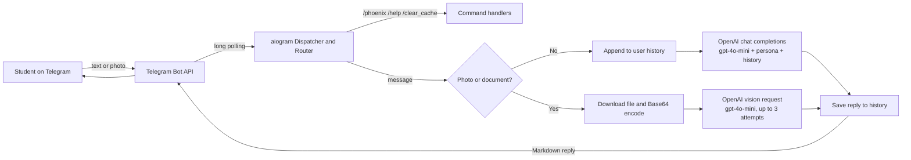

<div align="center">

# Phoenix Telegram Bot 2.0

**A 24/7 AI study companion on Telegram that answers admission-test doubts, including photos of questions, for students in Bangladesh.**

[](#the-problem)
[](https://www.python.org/)
[](https://docs.aiogram.dev/)
[](https://platform.openai.com/)
[](https://flask.palletsprojects.com/)
[](https://phoenix-telegram-bot-2-0-btt1.vercel.app)

[Live deployment](https://phoenix-telegram-bot-2-0-btt1.vercel.app) · [How it works](#how-it-works) · [Getting started](#getting-started)

</div>

---

## The problem

Students preparing for **private university admission tests in Bangladesh** get stuck on questions at all hours, and mentors cannot answer every doubt in real time. **Phoenix Education / Phoenix Admission Care** needed a helper that lives where students already are (Telegram), answers instantly, and explains things the way a senior student would.

**Phoenix** is that helper: a Telegram bot that solves Math, English, Analytical Ability and General Knowledge questions in plain, friendly language, from either typed text or a photo of the question.

## Key features

| | Feature | Details |
|---|---|---|
| 💬 | **Text doubt solving** | Answers admission-related questions with `gpt-4o-mini`, guided by a custom persona prompt |
| 📸 | **Image question solving** | Accepts photos or image documents, sends them to the OpenAI vision endpoint, and uses the caption as the question |
| 🧠 | **Per-user conversation memory** | Keeps chat history per Telegram username so students can ask follow-ups |
| 🧑‍🎓 | **Human-like persona** | Introduces itself as Phoenix, speaks like a helpful senior, and solves math without LaTeX so answers read cleanly in Telegram |
| 🔁 | **Retry on vision calls** | Image requests are attempted up to 3 times |
| ⌨️ | **Typing indicator** | Shows "typing..." while an answer is being generated |
| 🌐 | **Health endpoint** | A small Flask server responds on `/` with a status message |

### Bot commands

| Command | Description |
|---|---|
| `/phoenix` | Start a fresh chat with Phoenix |
| `/help` | List available commands |
| `/clear_cache` | Clear your conversation history |

## How it works

The bot uses **aiogram 3** with long polling: on startup it deletes any existing webhook, then pulls updates from Telegram and routes them through a single router.



## Tech stack

| Layer | Technology |
|---|---|
| Language | Python |
| Telegram framework | aiogram 3.17 (async, Router based) |
| AI model | OpenAI `gpt-4o-mini` (chat + vision) via `openai` 1.59 |
| Image handling | Telegram file download + Base64 data URL |
| Health / keep-alive server | Flask 3.1 on a background thread (port 8080) |
| Deployment config | Vercel (`vercel.json`), Render (`render.yaml`) |

## Project structure

```
Phoenix_Telegram_bot_2.0/
├── api/
│   └── index.py        # Bot, handlers, OpenAI calls and Flask app
├── requirements.txt    # Pinned Python dependencies
├── vercel.json         # Rewrites all routes to /api/index
├── render.yaml         # Render web service definition
└── README.md
```

## Getting started

### Prerequisites

- Python 3
- A Telegram bot token from [@BotFather](https://t.me/BotFather)
- An OpenAI API key with access to `gpt-4o-mini`

### Run locally

```bash
git clone https://github.com/Tanvir-Chowdhury/Phoenix_Telegram_bot_2.0.git
cd Phoenix_Telegram_bot_2.0
python -m venv .venv && source .venv/bin/activate
pip install -r requirements.txt
python api/index.py
```

This starts the Flask health server on port `8080` and begins polling Telegram. Open your bot in Telegram and send `/phoenix`.

> Note: Telegram users need a username set, since conversation history is keyed by username.

## Configuration

The bot reads two settings, defined as constants near the top of `api/index.py`:

| Name | Purpose |
|---|---|
| `TELEGRAM_TOKEN` | Telegram Bot API token |
| `OPENAI_API_KEY` | OpenAI API key |

Keep real keys out of version control. Loading them from environment variables of the same name (for example with `os.environ`) is the recommended setup.

## Deployment

The repo ships config for two platforms:

- **Vercel** (`vercel.json`): rewrites every route to `api/index`, which exposes the Flask `app`. Live at [phoenix-telegram-bot-2-0-btt1.vercel.app](https://phoenix-telegram-bot-2-0-btt1.vercel.app).
- **Render** (`render.yaml`): a Python web service that runs `pip install -r requirements.txt` and starts with `uvicorn api.index:app --host 0.0.0.0 --port 8000`.

Because the bot uses long polling, it needs a long-running process (`python api/index.py`) to keep answering messages.

## Limitations

- Conversation history lives in memory and resets when the process restarts.
- Image answers depend on photo clarity.
- Image requests are answered from the image and caption only, not prior history.
- OpenAI usage is billed per request.

## Author

Built by **Md Tanvir Chowdhury** for Phoenix Education / Phoenix Admission Care.

[](https://github.com/Tanvir-Chowdhury)
[](https://tanvir-chowdhury.github.io/tanvir-portfolio/)
